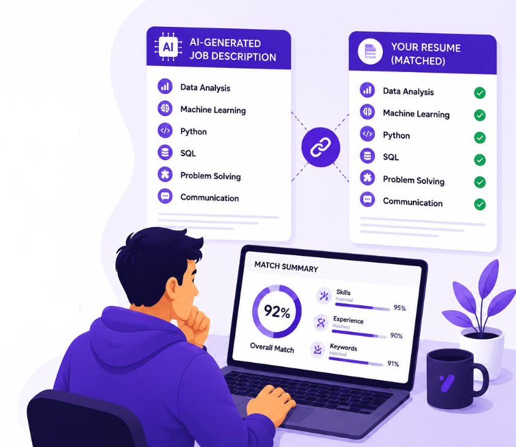
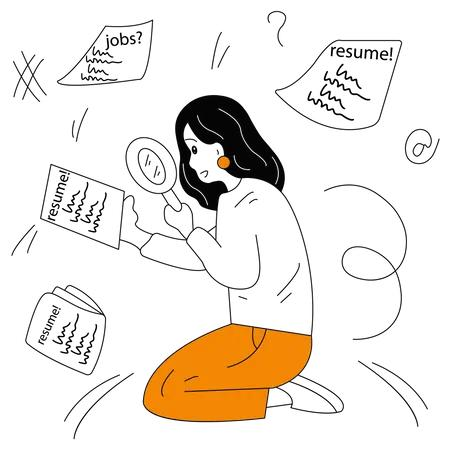
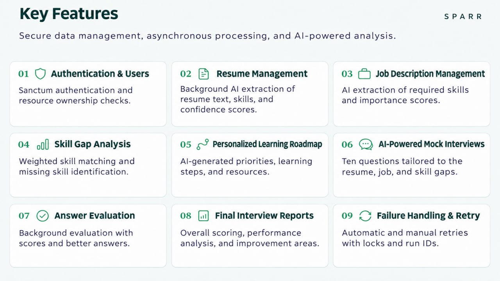
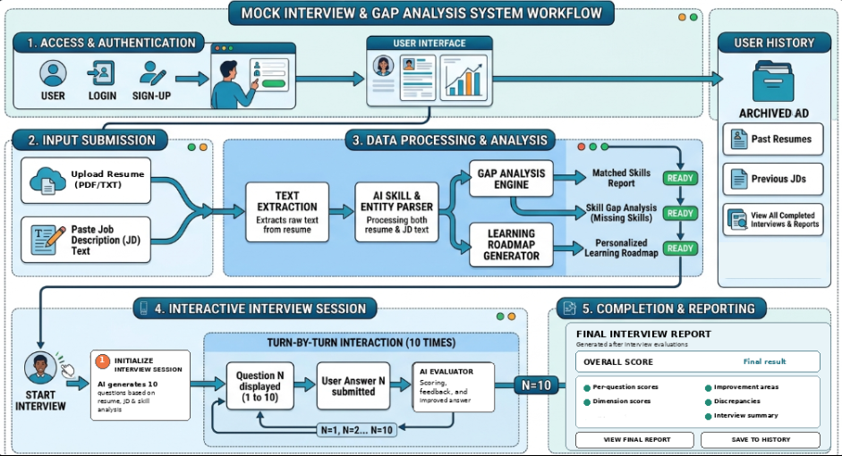

# Sparr: AI-Powered Interview Preparation and Evaluation Platform

## 1. Project Overview

Preparing for a job interview is not just about practicing common questions. It is about understanding what a specific job requires and how well your qualifications meet those requirements.

This is the idea behind Sparr.

Sparr bridges the gap between job requirements and candidate qualifications by combining AI-powered skill analysis, personalized learning roadmaps, and interview practice in one platform.

It guides candidates through a structured preparation journey, helping them identify what they need to improve and prepare for their target jobs.

---

## 2. The Problem

Before developing Sparr, we identified four main challenges that candidates face during interview preparation.

- **Generic Interview Preparation:** Traditional methods rely on common questions and answers that may not reflect the requirements of a specific job.
- **Difficulty Identifying Skill Gaps:** Candidates often struggle to understand the difference between their current qualifications and the skills required by employers.
- **Lack of Clear Preparation Direction:** Candidates may not know which skills to improve or how to prioritize their learning before an interview.
- **Time-Consuming Preparation:** Preparing through scattered resources and unrelated materials makes the process less organized and effective.

  These challenges make interview preparation less focused and effective.

  

---

## 3. Our Solution

To address these challenges, we developed Sparr to make interview preparation more personalized and organized.

Our solution focuses on three main features.

- **Personalized Preparation:** Prepare candidates based on their skills and target job requirements.
- **Focused Learning:** Help candidates identify and improve their skill gaps.
- **Interview Practice:** Provide AI-powered mock interviews with personalized feedback.

Sparr brings the entire preparation process together in one platform.

---

## 4. Target Users

Sparr is designed for individuals who want to improve their job readiness and prepare for career opportunities, including:

- **Fresh Graduates:** Preparing for their first job interviews and entering the job market.
- **Job Seekers:** Looking to improve their interview skills and prepare for specific job opportunities.
- **Career Changers:** Transitioning into new fields and identifying the skills they need to develop.

---

## 5. Key Features

Sparr provides integrated features that support candidates throughout their interview preparation journey.

---

## 6. Workflow

The following workflow illustrates how Sparr guides candidates through each stage of the interview preparation process, from uploading their resumes to receiving their final interview reports.

---

## 7. Technologies Used

Sparr is built using the following technologies:

- **React:** For building the user interface.
- **Laravel:** For backend development and data management.
- **Python & FastAPI:** For AI services and processing.
- **Google Gemini:** For AI-powered analysis, interview question generation, and answer evaluation.
- **Docker:** For containerizing services.

---

## 8. Live Demo

Now, let's walk through Sparr and see how the platform works through a practical demonstration.

Link: https://sparr-ai.mooo.com/
---

## 9. Team Members & Contributions

- **Hamza Albaghday** — Backend Development
- **Bara'a Bouzia** — Frontend Development
- **Mahmoud Hamdouna** — Backend Development
- **Hanan Abuzainab** — AI Development

Together, the team combines backend, frontend, and AI expertise to build and deliver Sparr.

---

## 10. Future Improvements

- **Additional Resume Formats:** Support more file formats for resume uploads.
- **Adaptive Interview Difficulty:** Adjust question difficulty based on candidate performance.
- **Learning Progress Tracking:** Enable candidates to track their progress in completing learning roadmaps and improving their skills.
